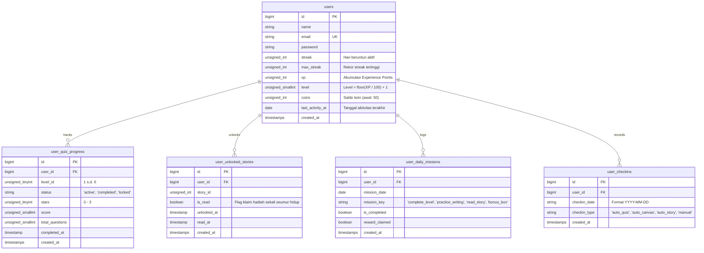

# Skema Basis Data & Logika Gamifikasi: Aksantara

Dokumen ini mendokumentasikan skema tabel basis data relasional, batasan indeks, serta aturan bisnis matematis pada sistem gamifikasi dan ekonomi koin Aksantara.

---

## 1. Diagram Relasi Entitas (ERD)

---

## 2. Struktur Kolom & Indeks Tabel

### 2.1. Tabel `users`
Tabel akun pengguna dan agregasi profil gamifikasi.
- **Indeks**: Primary Key (`id`), Unique (`email`).

| Kolom | Tipe Data | Default | Keterangan |
| :--- | :--- | :--- | :--- |
| `id` | `BIGINT UNSIGNED` | Auto Increment | Primary Key |
| `name` | `VARCHAR(255)` | - | Nama lengkap / tampilan anak |
| `email` | `VARCHAR(255)` | - | Email pengguna (**UNIQUE**) |
| `password` | `VARCHAR(255)` | - | Hash sandi Bcrypt / Argon2 |
| `streak` | `INT UNSIGNED` | `0` | Hari berturut-turut belajar saat ini |
| `max_streak` | `INT UNSIGNED` | `0` | Rekor streak tertinggi sepanjang waktu |
| `xp` | `INT UNSIGNED` | `0` | Total Experience Points |
| `level` | `SMALLINT UNSIGNED` | `1` | Dihitung otomatis: $\lfloor \text{XP}/100 \rfloor + 1$ |
| `coins` | `INT UNSIGNED` | `50` | Saldo koin virtual (modal awal 50) |
| `last_activity_at` | `DATE` | `NULL` | Tanggal kalender aktivitas belajar terakhir |

### 2.2. Tabel `user_quiz_progress`
Mencatat kemajuan per level di peta petualangan kuis.
- **Indeks Unik**: `UNIQUE(user_id, level_id)`.

| Kolom | Tipe Data | Default | Keterangan |
| :--- | :--- | :--- | :--- |
| `id` | `BIGINT UNSIGNED` | Auto Increment | Primary Key |
| `user_id` | `BIGINT UNSIGNED` | - | FK ke `users.id` (`ON DELETE CASCADE`) |
| `level_id` | `TINYINT UNSIGNED` | - | Nomor level petualangan (1–6) |
| `status` | `VARCHAR(20)` | `'locked'` | Status: `'locked'`, `'active'`, atau `'completed'` |
| `stars` | `TINYINT UNSIGNED` | `0` | Bintang perolehan (0–3 ⭐) |
| `score` | `SMALLINT UNSIGNED` | `0` | Skor perolehan kuis |
| `total_questions` | `SMALLINT UNSIGNED` | `0` | Jumlah soal per level |
| `completed_at` | `TIMESTAMP` | `NULL` | Waktu pertama kali level selesai |

### 2.3. Tabel `user_unlocked_stories`
Status kepemilikan dongeng dan validasi klaim hadiah satu kali.
- **Indeks Unik**: `UNIQUE(user_id, story_id)`.

| Kolom | Tipe Data | Default | Keterangan |
| :--- | :--- | :--- | :--- |
| `id` | `BIGINT UNSIGNED` | Auto Increment | Primary Key |
| `user_id` | `BIGINT UNSIGNED` | - | FK ke `users.id` (`ON DELETE CASCADE`) |
| `story_id` | `INT UNSIGNED` | - | ID dongeng yang dibuka (Cerita 1 gratis) |
| `is_read` | `BOOLEAN` | `false` | Status selesai dibaca & hadiah diambil |
| `unlocked_at` | `TIMESTAMP` | `CURRENT_TIMESTAMP` | Waktu dongeng dibuka |
| `read_at` | `TIMESTAMP` | `NULL` | Waktu menekan "Tandai Selesai Membaca" |

### 2.4. Tabel `user_daily_missions`
Mencatat progres 3 misi harian dan peti bonus spesial.
- **Indeks Unik**: `UNIQUE(user_id, mission_date, mission_key)`.

| Kolom | Tipe Data | Default | Keterangan |
| :--- | :--- | :--- | :--- |
| `id` | `BIGINT UNSIGNED` | Auto Increment | Primary Key |
| `user_id` | `BIGINT UNSIGNED` | - | FK ke `users.id` (`ON DELETE CASCADE`) |
| `mission_date` | `DATE` | - | Tanggal misi (`YYYY-MM-DD`) |
| `mission_key` | `VARCHAR(50)` | - | `complete_level`, `practice_writing`, `read_story`, `bonus_box` |
| `is_completed` | `BOOLEAN` | `false` | Apakah tugas sudah terpenuhi |
| `reward_claimed` | `BOOLEAN` | `false` | Status hadiah telah diambil |

### 2.5. Tabel `user_checkins`
Mencatat histori presensi untuk pembentukan tracker mingguan.
- **Indeks Unik**: `UNIQUE(user_id, checkin_date)`.

| Kolom | Tipe Data | Default | Keterangan |
| :--- | :--- | :--- | :--- |
| `id` | `BIGINT UNSIGNED` | Auto Increment | Primary Key |
| `user_id` | `BIGINT UNSIGNED` | - | FK ke `users.id` (`ON DELETE CASCADE`) |
| `checkin_date` | `VARCHAR(10)` | - | Tanggal presensi (`YYYY-MM-DD`) |
| `checkin_type` | `VARCHAR(30)` | `'auto'` | `auto_quiz`, `auto_canvas`, `auto_story`, `manual` |

---

## 3. Logika Gamifikasi & Ekonomi Virtual

### 3.1. Rumus Kenaikan Level Otomatis
Tingkat level bertambah setiap kelipatan **100 XP**:
$$\text{Level} = \max\left(1, \left\lfloor \frac{\text{XP}}{100} \right\rfloor + 1\right)$$
$$\text{Sisa XP Level Ini} = \text{XP} \bmod 100, \quad \text{Persentase} = \min\left(100, \frac{\text{Sisa XP}}{100} \times 100\%\right)$$

### 3.2. Neraca Koin Virtual (*Inflow & Outflow*)
- **Saldo Awal**: User baru otomatis memperoleh **50 Koin**.
- **Inflow (Pemasukan)**:
  - Selesaikan Level Kuis: $+10 \text{ s.d. } +25$ Koin.
  - Selesaikan Misi Harian: $+15 \text{ s.d. } +25$ Koin per misi.
  - Bonus Box (3 Misi Lengkap): $+30$ Koin & $+50$ XP.
  - Selesai Membaca Dongeng (pertama kali): $+10$ Koin & $+50$ XP.
- **Outflow (Pengeluaran)**:
  - Bantuan Hint Kuis: $-5$ Koin (mengeliminasi 2 opsi salah).
  - Membuka Dongeng Terkunci: $-30$ Koin.

### 3.3. Aturan Streak & Presensi
- Nilai `streak` bertambah $+1$ jika pengguna menyelesaikan kuis, kanvas, dongeng, atau check-in manual pada hari kalender baru.
- **Aturan Reset**: Jika $\text{last\_activity\_at} < (\text{Hari Ini} - 1\text{ hari})$, maka nilai `streak` direset ke `0`.
- **Rekor Terbaik**: Nilai `max_streak` diperbarui otomatis jika `streak > max_streak`.

### 3.4. Kebijakan Anti-Abuse Dongeng (*One-Time Claim*)
- Tombol "Tandai Selesai Membaca" memvalidasi kolom `is_read` pada database server.
- Hadiah $+50$ XP & $+10$ Koin hanya diberikan 1 kali seumur hidup per dongeng. Panggilan berikutnya mengembalikan `{ "alreadyClaimed": true, "xpEarned": 0, "coinsEarned": 0 }` dan tombol UI berstatus disabled.

### 3.5. Peringkat Jawara Aksara (Leaderboard Real-Time)
- Diurutkan berdasarkan: `ORDER BY streak DESC, xp DESC`.
- Menampilkan data pengguna asli dari tabel `users` tanpa akun dummy/palsu.
- Jika pengguna aktif berada di luar peringkat 3 besar, baris personal ditampilkan di bawah leaderboard.
